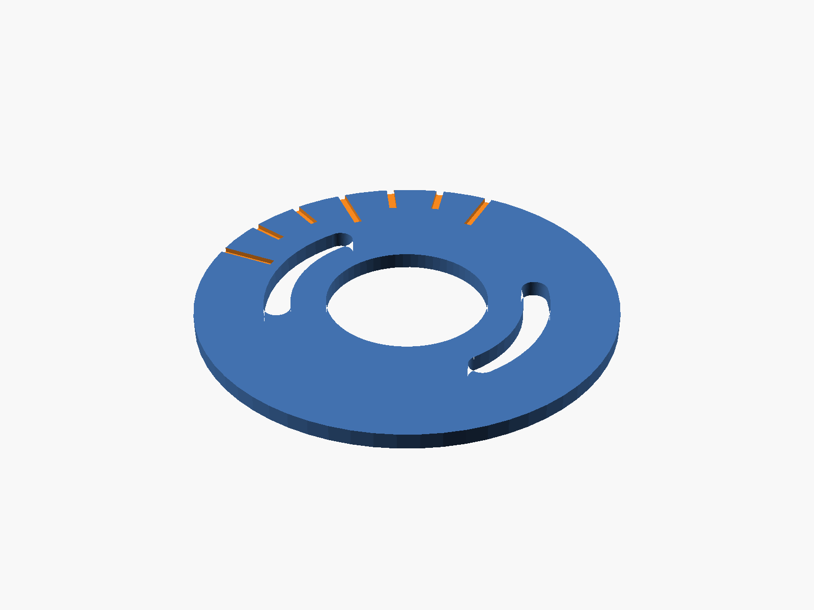

# Guía de Producción: Puntero láser estelar motorizado

Montura motorizada de dos ejes (altitud-azimut) que apunta un puntero láser verde "303" a cualquier
estrella del cielo. Se enrosca al tornillo 3/8"-16 de un trípode de telescopio. Un ESP32 mueve dos
motores 28BYJ-48 a través de correas GT2 con reducción 1:4 y enciende el láser con un relé. El láser
va **sin su batería**: una pila falsa impresa y una tapa trasera impresa lo conectan al power bank a
través del relé y de un regulador a 3,7 V, así que con el ESP32 apagado el láser queda sin energía. La
mecánica está pensada para un error de apuntado menor a 2°: el presupuesto estimado es de 0,5° (suma
cuadrática) y 1,35° en el peor caso.


```text
                    polea de altura 80T (por fuera del brazo)
                         │      cuna con el láser (gira en altura, −10° … 95°)
                         ▼     ┌──────────────────────────┐
      brazo "cable" ║════════[cuna]════════║ brazo "motor" ◄── motor de altura + carro (pilares)
                    ║                      ║          │ correa GT2 200 mm
   ─X  power bank ┌─╨──────────────────────╨─┐ tapa: ESP32, relé, regulador,    +X
       (de pie)   │      plataforma de azimut │ 2 × ULN2003, interruptor y cables
                  └────────────┬─────────────┘
          motor de azimut (+Y) │ perno M8, 2 × 608ZZ
                  ┌────────────┴─────────────┐
                  │  base + polea fija 80T    │  ◄── correa GT2 200 mm (bajo la plataforma)
                  └────────────┬─────────────┘
                       tuerca 3/8"-16 ── trípode
```

| Archivo | Uso |
|---------|-----|
| `exports/puntero_laser_*.stl` (14 archivos) | Piezas listas para el laminador (valores por defecto) |
| `src/puntero_laser_parametros.scad` | Medidas compartidas: el único archivo que hay que editar para adaptar el diseño (sección 4) |
| `src/puntero_laser_<pieza>.scad` | Una pieza por archivo |
| `src/puntero_laser_ensamblaje.scad` | Vista del conjunto con comprobaciones de choque (no se imprime) |

### Valores del diseño entregado

| Parámetro | Valor | Parámetro | Valor |
|-----------|-------|-----------|-------|
| `diametro_laser` | 20 mm (medido) | `largo_laser` | 152 mm (medido) |
| `distancia_trasera_centro_masa` | 76 mm | `masa_laser_g` | 130 g |
| `powerbank_largo × _ancho × _alto` | 147 × 71 × 16 mm | `esp32_largo × _ancho` | 48 × 25,5 mm (NodeMCU-32S, filas a 22,86 mm) |
| `rele_largo × _ancho` | 50 × 26 mm | `uln2003_largo × _ancho` | 35 × 32 mm |
| `dientes_polea_conducida` | 80 | `largo_correa` | 200 mm |
| `espesor_brazo` | 12 mm | `ajuste_608` | +0,10 mm |
| `holgura_encastre` | 0,25 mm | `holgura_colimacion` | 2 mm por lado |
| `largo_tubo_cuna` | 80 mm | `paso_escala` / `angulo_escala_max` | 15° / 90° (escala de altura) |
| `diametro_hueco_bateria` | 18,5 mm (18650) | `profundidad_hueco_bateria` | 65 mm |
| `diametro_zona_tapa` | 20 mm | `largo_zona_tapa` | 10 mm |
| `largo_tapa_original` | 20 mm | `tuercas_lastre_tapa` | 0 (sin lastre) |
| `masa_bateria_g` / `masa_tapa_original_g` | 45 g / 10 g | `regulador_largo × _ancho` | 22 × 17 mm (MP1584EN) |

> **Del láser solo están medidos el diámetro del tubo (20 mm) y el largo (152 mm).** El punto de
> equilibrio, la masa, el hueco de la batería y la rosca de la tapa son supuestos para un 303 de
> 20 mm con batería 18650. Hay que reemplazarlos por los de tu ejemplar antes de imprimir la pila
> falsa y la tapa trasera (sección 4.1).

Cotas que resultan (las imprime `src/puntero_laser_parametros.scad` con `echo`):

| Cota | Valor |
|------|-------|
| Distancia entre los centros de las poleas | 45,97 mm |
| Altura del eje de altura sobre la plataforma | 109,5 mm (180,0 mm sobre el trípode); con un láser corto la fija el motor de altura, que tiene que pasar por encima del de azimut y de la tapa |
| Plataforma | 173,3 × 185,9 mm |
| Láser convertido (sin batería, con pila falsa, tapa y grapa; sin lastre) | ≈ 98 g, equilibrado a 72,9 mm de la cola |
| Hueco entre la tapa trasera y la cuna (grapa y equilibrado) | 15,3 mm |
| Caída de tensión en el cable del láser | 0,08 V |
| Tapa de la electrónica | 33,5 mm de alto; el ESP32 queda a 23,9 mm de la plataforma (espacio para los Dupont) |
| Cables de los motores (recorrido hasta su ULN2003) | altura ≈ 135 mm, azimut ≈ 160 mm, de 230 mm de fábrica |
| Centro de masa de la parte giratoria | a ≈ 5 mm del eje |
| Masa total estimada del aparato | ≈ 930 g |
| Brazo motor con la aguja de índice | 144,4 mm de largo; la aguja sube 42 mm sobre la cara exterior y pasa a 2,1 mm de la correa |

## Primeros pasos

1. **Medir tus componentes** antes de imprimir nada: diámetro, largo y punto de equilibrio del láser,
   el hueco de su batería y la rosca de su tapa trasera, y las medidas del power bank y de las placas
   (sección 4.1). Si difieren de los valores del diseño
   entregado, cargarlos en `src/puntero_laser_parametros.scad` y regenerar los STL (sección 4.3).
2. **Imprimir la probeta del 608** y calibrar `ajuste_608` (sección 3.1). Si el valor cambia,
   regenerar los 14 STL.
3. **Imprimir el resto de las piezas** en PETG (sección 1).
4. **Comprar los componentes** de la lista de materiales (sección 2). Con el relé, fijarse que sea
   compatible con 3,3 V (sección 5.4). Herramientas: un **multímetro** (para ajustar el regulador,
   probar el contacto del tubo y la barra de distribución), un **soldador de 30 a 40 W** y **estaño de
   0,8 mm con resina** (barra de distribución, interruptor, cable USB y regulador).
5. **Armar** siguiendo los pasos de la sección 2 y hacer la **puesta a punto** (sección 3), con una
   cinta métrica para el cero de la escala de altura (sección 3.7).
6. **En el campo**, orientar la base al sur con el celular o una brújula y dejar el aparato en la
   posición de partida antes de encenderlo (sección 2, "Orientación al sur").

## 1. Especificaciones de Impresión 3D

> **Holguras por defecto, no medidas.** Este proyecto todavía no tiene un perfil de impresora medido
> (`src/perfil_impresora.scad`). Los encajes de este diseño usan valores genéricos para FDM con
> boquilla de 0,4 mm:
>
> - encastres de 0,25 mm;
> - paso de M3 de 0,3 mm;
> - alojamientos de tuerca de 0,2 mm;
> - paso de M8 de 0,4 mm;
> - 608 a presión con +0,10 mm.
>
> Las piezas del láser sin batería toman sus holguras de `src/perfil_impresora.scad`, que tiene
> `perfil_medido = false`, así que también son **valores por defecto, no medidos**: la funda de la
> tapa trasera es deslizante (+0,30 mm), la pila falsa entra suelta (−0,40 mm) y la grapa va a
> presión (0,15 mm).
>
> Los más críticos son los alojamientos de los 608: calibrarlos con la probeta (3.1) antes de
> imprimir el resto.

**Orden de impresión**: imprimir **primero la probeta de ajuste del 608** (sección 3.1). Si el valor
de `ajuste_608` cambia, hay que **regenerar los 14 STL** antes de imprimir el resto.

| Pieza | STL | Cant. | Orientación (cara sobre la cama) | Relleno | Perímetros | Soportes | Adherencia | Masa maciza* |
|-------|-----|-------|----------------------------------|---------|------------|----------|------------|--------------|
| Probeta de ajuste del 608 | `puntero_laser_probeta_ajuste_608.stl` | 1 | Plana, tal como viene | 15 % | 3 | No | — | 13 g |
| Adaptador del trípode (base) | `puntero_laser_adaptador_tripode.stl` | 1 | Cara de apoyo del trípode | 40 % giroide | 4 | No | — | 254 g |
| Plataforma de azimut | `puntero_laser_plataforma_azimut.stl` | 1 | Cara inferior | 20 % giroide | 3 | No | Borde (brim) de 5 mm si la cama despega esquinas | 220 g |
| Brazo de la horquilla, motor | `puntero_laser_brazo_horquilla_motor.stl` | 1 | Cara interior (pilares y aguja de índice hacia arriba) | 30 % | 4 | No | — | 109 g |
| Brazo de la horquilla, cable | `puntero_laser_brazo_horquilla_cable.stl` | 1 | Cara interior (canal hacia arriba) | 30 % | 4 | No | — | 57 g |
| Cuna del láser | `puntero_laser_cuna_laser.stl` | 1 | De pie, sobre un anillo de colimación | 30 % | 4 | No | Borde (brim) de 5 mm | 35 g |
| Polea de altura | `puntero_laser_polea_altitud.stl` | 1 | Cara exterior (cubo hacia arriba) | 40 % | 4; capa de 0,16 mm | No | — | 24 g |
| Disco de la escala de altura | `puntero_laser_disco_escala.stl` | 1 | Plano, escala hacia arriba; mejor en un **color claro** | 100 % | — | No | — | 4 g |
| Carro del motor | `puntero_laser_carro_motor.stl` | **2** | Plano | 40 % | 4 | No | — | 8 g c/u |
| Separador y 3 arandelas | `puntero_laser_separador_azimut.stl` | 1 | De pie, tal como viene | 100 % | — | No | — | 2 g |
| Tapa de la electrónica | `puntero_laser_tapa_electronica.stl` | 1 | Techo | 15 % | 3 | No | — | 58 g |
| Pila falsa | `puntero_laser_pila_falsa.stl` | 1 | De pie, cara trasera (la de la ranura) | 30 % | 3 | No | Borde (brim) de 3 mm | 19 g |
| Tapa trasera del láser | `puntero_laser_tapa_trasera.stl` | 1 | De pie, piso trasero | 40 % | 4 | No | — | 8 g |
| Grapa del cable | `puntero_laser_grapa_cable.stl` | 1 | Plana | 100 % | — | No | — | 1 g |

\* Masa si la pieza fuera maciza de PETG. Con los ajustes de la tabla, el conjunto impreso pesa
≈ 440 g; el laminador da el valor exacto. La aguja de índice del brazo motor (4 × 5 mm, 42 mm de
alto) sale vertical y sin soportes; conviene imprimir el brazo a velocidad normal, sin ventilador al
máximo en las últimas capas, para que la aguja no se tuerza.

| | | |
|---|---|---|
|  Base |  Plataforma |  Cuna |
|  Brazo motor |  Brazo cable |  Polea de altura |
|  Carro (×2) |  Separador y arandelas |  Tapa |
|  Probeta del 608 |  Pila falsa |  Tapa trasera |
|  Disco de la escala | | |
|  Grapa del cable | | |

**Ninguna pieza necesita soportes.** Los únicos voladizos son puentes cortos: los techos de las
tuercas embebidas, los puentes de la canaleta del cable de la cuna, la ranura de la tuerca de la pila
falsa, las ventanas con techo a dos aguas (ningún puente supera 10 mm), y la repisa anular de 3 mm
sobre el alojamiento del 608 inferior de la base. Los resaltes de los prisioneros de la tapa trasera
tienen chaflán de 45° por debajo. Los muñones de la cuna, la ventana de la base y las pestañas
de las poleas tienen perfiles a 45°.

**Configuración común del laminador**:

- Capa de 0,2 mm (0,16 mm en las poleas, para que los dientes GT2 salgan definidos).
- 5 capas superiores e inferiores.
- Sin "alisado" (ironing) en las caras de apoyo de los rodamientos.

**Material recomendado: PETG**, con boquilla a 230–245 °C y cama a 70–85 °C. Resiste la humedad
nocturna y la temperatura dentro de un auto al sol. El PLA sirve para pruebas, pero se ablanda a
~55 °C.

> **Bambu Lab A1**: imprimir el PETG sobre la placa texturizada de PEI, que se despega sola al
> enfriarse. En una placa lisa (PEI liso o Cool Plate SuperTack) el PETG se pega demasiado y puede
> arrancar trozos de la superficie: usar laca o pegamento en barra como desmoldeante. En Bambu Studio
> sirve el perfil "Generic PETG" o el de la marca del filamento. Al ser abierta, no conviene ABS ni ASA.

## 2. Ensamblaje y Lista de Materiales (BOM)

### Herrajes / Tornillería Requerida

<!-- BOM:inicio (generado desde docs/puntero_laser_bom.csv con scripts/generar_web.py: no editar a mano) -->
**Rodamientos, poleas y correas**

* 4 × Rodamiento 608ZZ (22 × 8 × 7 mm)
* 2 × Polea GT2 20 dientes, agujero de 5 mm, para correa de 6 mm (con 2 prisioneros)
* 2 × Correa GT2 cerrada de 200 mm × 6 mm (100 dientes)

**Pernos y tuercas M8 y del trípode**

* 1 × Perno M8 × 50 mm cabeza hexagonal (eje de azimut)
* 1 × Perno M8 × 55 mm cabeza hexagonal (eje de altura, lado del motor: entra desde afuera por la polea)
* 1 × Perno M8 × 25 mm cabeza hexagonal (eje de altura, lado del cable: entra desde afuera por la arandela de contacto)
* 1 × Tuerca autoblocante M8 (eje de azimut)
* 2 × Tuerca M8 común de 6,5 mm de alto (DIN 934), para los muñones de la cuna
* 1 × Tuerca 3/8"-16 UNC (tornillo del trípode)
* 2–4 × Arandela M8 fina (solo si hace falta ajustar la horquilla a la plataforma, paso 8)
* 4 × Tuerca M8 extra como contrapeso (opcional, sección 3.4)

**Tornillería M3**

* 4 × Tornillo M3 × 12 mm + 4 × tuerca M3: pies de los brazos
* 2 × Tornillo M3 × 10 mm + 2 × tuerca M3: carro de azimut
* 2 × Tornillo M3 × 12 mm: carro de altura, autorroscante en los pilares
* 4 × Tornillo M3 × 8 mm + 4 × arandela M3: orejas de los motores, autorroscante en el carro
* 2 × Tornillo M3 × 8 mm + 2 × arandela M3: disco de la escala de altura, autorroscante en la polea
* 2 × Tornillo M3 × 16 mm: tensores, autorroscante en los topes
* 6 × Prisionero M3 × 8 mm (DIN 916, punta plana): colimación del láser
* 1 × Tornillo M3 × 12 mm para roscar previamente los agujeros de los prisioneros (se retira)
* 2 × Tornillo M3 × 10 mm + 2 × tuerca M3: tapa
* 2 × Prisionero M3 × 12 mm punta cónica (DIN 914) + 2 × tuerca M3: tapa trasera del láser (uno es el contacto negativo)
* 1 × Tornillo M3 × 8 mm cabeza alomada (ISO 7380) + 1 × tuerca M3: contacto positivo de la pila falsa

**Electrónica**

* 1 × ESP32 NodeMCU-32S de 38 pines (48 × 25,5 mm, filas a 22,86 mm)
* 2 × Motor paso a paso 28BYJ-48 de 5 V con su placa driver ULN2003
* 1 × Módulo relé de 1 canal **compatible con lógica de 3,3 V**: disparo por nivel alto, o con puente "H/L" en H
* 1 × Resistencia de 10 kΩ 1/4 W, entre IN y GND del relé (láser apagado con el ESP32 apagado)
* 1 × Módulo reductor de tensión ajustable MP1584EN (o mini-360), ajustado a 3,7 V
* 2 × Terminal de ojal M3 para cable de 26 AWG (contactos + y − del láser)
* 1 × Puntero láser verde "303" (se usa sin su batería: la batería y la tapa original se guardan)
* 1 × Power bank USB de 5 V y ≥ 2 A (Energizer Max de 10 000 mAh o similar)
* 1 × Interruptor de palanca miniatura con rosca M6 (tipo MTS-102)
* 1 × Cable USB-A con salida a bornes (o cable USB cortado)
* 70 cm de cable de silicona de 2 × 26 AWG, rojo y negro (regulador → láser e interruptor → barra de distribución)
* 1 × Placa perforada (placa experimental) de paso 2,54 mm: se corta un trozo de 3 × 10 agujeros para la barra de distribución +5 V / GND
* 1 × Tira de pines macho 1 × 40 de paso 2,54 mm (se cortan 2 tiras de 6 para la barra de distribución)
* Cables Dupont hembra-hembra rectos (conector de 14 mm)
* 20 cm de tubo termocontraíble de 2,5 mm (soldaduras del interruptor, del cable USB y del regulador)
* Bridas de 3 mm
* Una banda elástica o una tira de velcro para el power bank
<!-- BOM:fin -->

### Instrucciones Paso a Paso

Antes de empezar, retirar los restos de impresión de todos los alojamientos y probar el ajuste de los
608 (sección 3.1).

1. **Base: tuerca del trípode.** Dejar caer la tuerca 3/8"-16 por arriba de la base hasta su
   alojamiento hexagonal del fondo. El tornillo del trípode la tira contra el piso.
2. **Base: rodamientos de azimut.** Prensar un 608ZZ desde arriba en el alojamiento superior. Meter
   el segundo 608 por la ventana lateral y prensarlo hacia arriba en el alojamiento inferior: se puede
   tirar de él con el perno M8 × 50, arandelas y una tuerca. Los dos quedan apoyados contra el resalte
   central.
3. **Cuna: tuerca del lado del cable.** Meter una tuerca M8 común por un extremo del tubo y encajarla
   en el hexágono del muñón −X (el que está junto a la canaleta del cable). Se sostiene con un dedo
   hasta el paso 6; un poco de cinta de papel por dentro del tubo evita que se caiga.
4. **Brazos: rodamientos.** Prensar un 608ZZ en cada brazo desde la cara exterior, hasta que quede
   enrasado y apoyado en el labio interior.
5. **Cuna entre los brazos.** La horquilla se arma con los brazos **sueltos**: atornillados a la
   plataforma quedan a 40 mm, y la cuna con sus anillos de contacto mide 50 mm. Calzar el **brazo
   cable** sobre el anillo de contacto del muñón −X hasta que apoye en el aro interior del 608. Del otro lado, calzar el **brazo motor** sobre el anillo del muñón +X. Las caras interiores
   de los brazos miran hacia la cuna.
6. **Lado del cable.** Pasar el perno M8 × 25 por la arandela de contacto **gruesa** (la de 5,3 mm
   del separador impreso) y meterlo desde afuera por el 608 del brazo cable y el muñón hasta la tuerca
   del paso 3. Enroscarlo con una llave de 13 mm sosteniendo la cuna, hasta que apriete: la cabeza
   apoya en la arandela, la arandela en el aro interior del 608, y el perno gira con la cuna. La punta
   queda 0,5 mm antes del interior del tubo y no toca el láser.
7. **Polea de altura.** Meter la otra tuerca M8 común por un extremo del tubo y encajarla en el hexágono del
   muñón +X; sostenerla con un dedo. Pasar el perno M8 × 55 por la polea 80T desde la cara exterior,
   con la cabeza en el hexágono, y llevarlo con el cubo de la polea hacia el brazo motor: atraviesa el
   608 y el muñón y llega a la tuerca. Enroscarlo **girando la polea** mientras se sostiene la cuna,
   hasta que apriete; no hace falta llave. La cabeza hace de chaveta: la polea, el perno y la cuna
   giran juntos. La punta queda 0,5 mm antes del interior del tubo y no toca el láser. Apoyar el
   **disco de la escala** sobre la cara exterior de la polea, con las rayas hacia afuera, y fijarlo con
   2 × M3 × 8 con arandela, autorroscantes por las ranuras en los 2 agujeros chicos de la polea, **sin
   apretar**: el cero se pone en la puesta a punto (sección 3.7).
8. **Horquilla a la plataforma.** Colocar una tuerca M3 en cada ranura del pie de los brazos,
   entrándola por la cara exterior del brazo. Bajar la horquilla armada (brazos, cuna y polea) a los
   marcos de la plataforma: el **brazo motor** en +X (lado de la tapa) y el **brazo cable** en −X (lado
   del power bank). Fijar cada brazo con 2 × M3 × 12 desde abajo de la plataforma. Si para que los pies
   entren en los marcos hay que separar los brazos, la cuna queda corta: sacar el perno del lado cable y el
   brazo cable, poner arandelas M8 finas entre el anillo del muñón y el 608, y volver a armar ese lado.
9. **Motores a los carros.** Atornillar cada 28BYJ-48 a un carro con 2 × M3 × 8 y arandela,
   autorroscantes en los agujeros de las orejas. El cuerpo del motor queda hacia +X del carro, del
   lado contrario al agujero del eje.
10. **Motor de azimut.** Colocar las 2 tuercas M3 en los hexágonos de la cara inferior de la
    plataforma, bajo el asiento del carro (+Y). Apoyar el carro con el motor encima y el eje hacia
    abajo, a través de la abertura alargada, con la cara del tensor hacia el tope. Fijarlo con
    2 × M3 × 10 sin apretar. Desde abajo, calzar la polea 20T en el eje, con el cubo hacia arriba metido
    en la abertura, y apretar sus prisioneros sobre la cara plana del eje.
11. **Plataforma sobre la base.** Colocar una arandela de contacto impresa sobre el aro interior del 608
    superior. Con la cuna horizontal, meter el perno M8 × 50 entre los brazos, por debajo de la cuna, y
    pasarlo por el cubo central: la cabeza queda en el hexágono, enrasada. Sosteniéndolo, bajar la
    plataforma sobre la base. Antes de que el perno salga por el 608 inferior, poner el **separador**
    entre los dos rodamientos. Por la ventana lateral, poner la segunda arandela de contacto y la
    tuerca autoblocante M8, y apretar con una llave de 13 mm hasta que **desaparezca el juego** y la
    plataforma gire suave, sin frenarse.
12. **Correa de azimut.** Pasar la correa de 200 mm alrededor de la polea fija de la base y de la polea
    20T. Tensar con el tornillo M3 × 16 del tope (sección 3.2) y apretar los 2 M3 del carro.
13. **Motor de altura.** Atornillar el carro con su motor sobre los 2 pilares del brazo motor con
    2 × M3 × 12 autorroscantes, sin apretar. El motor queda entre el carro y el brazo, con el eje hacia
    afuera. Calzar la polea 20T (cubo hacia el carro), pasar la correa, tensar con el tornillo del tope
    y apretar.
14. **Preparar el láser.** Antes de sacar la batería, fijarse hacia dónde apunta su **+** (en el 303
    suele ir hacia el cabezal). Desenroscar la tapa original y sacar la batería; guardar las dos para
    volver a usar el láser a mano (ver "Volver a la batería original").
    - **Prueba del tubo**: con el multímetro en continuidad, medir entre la rosca trasera y el cuerpo
      del cabezal. Debe dar < 1 Ω; si no, limar un punto de la rosca donde va a morder el prisionero.
    - **Pila falsa**: crimpar o soldar un terminal de ojal M3 al hilo **rojo**. Meter la tuerca M3 por
      la ranura lateral de la pila, poner el ojal sobre la cara delantera (la del "+") y apretar el
      tornillo M3 × 8 de cabeza alomada. Pasar el hilo por el agujero axial y sacarlo por la ranura de
      la cara trasera. Meter la pila en el tubo con la cabeza del tornillo hacia donde iba el + de la
      batería.
    - **Tapa trasera**: pasar el hilo rojo por la ranura del escalón y la ventana. Girar la pila falsa
      hasta que su ranura quede alineada con la ventana, y calzar la tapa sobre la rosca hasta que el
      borde del tubo apoye en el escalón (empuja la pila y comprime el resorte del cabezal).
    - **Prisioneros**: roscar los 2 prisioneros M3 × 12 de punta cónica hasta que muerdan la rosca del
      tubo. En el que está a 45° de la ventana, poner el ojal del hilo **negro** y apretarlo con una
      tuerca M3; en el otro, una tuerca M3 como contratuerca.
    - **Grapa**: calzarla a presión sobre el tubo, delante de la tapa, con su ojal alineado con la
      ventana, y meter los 2 hilos a presión en el ojal. La grapa es el alivio de tensión: un tirón del
      cable no llega a los contactos.
15. **Láser en la cuna.** Trabar el pulsador del láser en encendido. Si el pulsador es momentáneo (se
    apaga al soltarlo), puentearlo con un hilo soldado, a través de la ventana del pulsador de la cuna.
    Pasar el láser por la cuna con el cabezal hacia +Y (adelante), entrándolo **por el extremo
    trasero de la cuna, cabezal primero**: la tapa trasera no pasa por la cuna y queda atrás. Si el
    cabezal no pasa por la cuna, sacar la grapa y la tapa (aflojando los prisioneros, sin sacar la
    pila falsa), entrar el láser cola primero por el extremo delantero y volver a ponerlas. Enhebrar los 2 hilos por los
    3 puentes de la **canaleta** de la cuna (lado −X, abajo), desde el borde trasero hasta el muñón −X.
    Pasarlos por el agujero del brazo cable dejando un **bucle de 40 mm** y bajarlos por el canal de la
    cara exterior del brazo.
16. **Electrónica.** Armar y probar la **barra de distribución** en el banco (sección 5.4). Encajar las
    placas en sus soportes (lado +X): los 2 ULN2003, el **regulador** (en el tercer soporte de la misma
    columna), la **barra** (en el soporte angosto al lado del regulador, con los pines hacia arriba y
    las entradas soldadas hacia +Y) y el relé apoyados, y el ESP32 elevado, con los pines hacia
    abajo como viene de fábrica (sin la placa base que trae; apoya en los dos apoyos centrales de los
    extremos, entre las filas de pines). Cada placa va en un sentido, para que los cables lleguen cortos:
    - Los **ULN2003**, con la ficha del motor hacia −X (la pared por donde entran los cables de los
      motores) y las entradas IN1–IN4 y la alimentación hacia el ESP32 (+X).
    - El **relé**, con la tira VCC/GND/IN hacia el ESP32 (−Y) y la bornera hacia el interruptor (+Y).
    - El **regulador**, con la entrada (IN+ e IN−) hacia −Y y la salida hacia +Y.
    - El **ESP32**, con el USB hacia −Y, frente a la abertura de la tapa.
    - **Antes de encajar el ESP32, conectarle los Dupont** desde abajo y doblar los cables hacia el
      centro de la placa (hacia afuera chocan con la columna de los ULN2003): con la placa puesta, los
      conectores de abajo no se alcanzan. Los cables salen por debajo de la placa hacia los ULN2003,
      por el tramo cercano al relé, y el de GPIO23 sale entre el ESP32 y el relé.
    - Los Dupont del relé y de los ULN2003 van rectos hacia arriba; la tapa tiene lugar para ellos y
      la curva del cable.
    - Soldar la **resistencia de 10 kΩ** entre los pines IN y GND del relé, del lado de las
      soldaduras (o meterla en el cable Dupont). Atornillar el interruptor en su soporte, con la
      palanca hacia +X.
    - Colocar el power bank de pie en su bolsillo (−X), con el conector USB hacia el extremo bajo de
      la pared (−Y), y sujetarlo con la banda elástica alrededor del bolsillo.
17. **Cableado.** Conectar según la sección 5.4. **Antes de conectar los hilos del láser, ajustar el
    regulador a 3,7 V** (sección 5.4): 5 V directos queman el láser.
    - Todos los +5 V y GND salen de la **barra de distribución**, un Dupont por pin (tabla de la
      sección 5.4). Las señales van del ESP32 a cada placa con su Dupont.
    - El cable de alimentación y los hilos del láser cruzan por el **conducto elevado** (Y = −30 mm):
      el USB del lado −Y y los hilos del láser del lado +Y.
    - El **enchufe USB** va al puerto del power bank, por la pared baja del bolsillo. Sus hilos ya
      tienen identificados el +5 V y el GND (sección 5.4).
    - Los hilos del láser van al regulador: el rojo a OUT+ y el negro a OUT−.
    - El cable del motor de altura baja por el canal de la cara exterior del brazo motor.
    - El cable del motor de azimut se fija con una brida al puente de la plataforma y entra a la tapa
      por la pared −X.
    - El sobrante se enrolla en el hueco del extremo +Y, bajo la tapa.
    - Ningún cable debe tocar correas ni poleas.
18. **Tapa.** Bajar la tapa sobre el reborde de la plataforma (la palanca del interruptor entra por la
    ranura) y fijarla con 2 × M3 × 10 y tuerca en sus orejas.
19. **Puesta a punto.** Equilibrar y colimar el láser (secciones 3.3 y 3.5), poner el cero de la
    escala de altura (sección 3.7) y hacer las pruebas del láser de la sección 5.5.

### Montaje en el trípode

Enroscar la base a mano sobre el tornillo 3/8"-16 de la cabeza del trípode hasta que apoye firme;
no hacen falta herramientas y se hace en menos de 1 minuto. Nivelar el trípode a ojo (±2°): la
alineación con 2 estrellas corrige el resto (sección 5.3).

### Orientación al sur

La base tiene grabadas una **«S»** (sur) y una **«O»** (oeste), cada una con una línea vertical
debajo. El borde de la plataforma tiene una **raya** y un triángulo en la dirección a la que apunta el
láser. Con la raya frente a la «S», el láser apunta hacia la «S»; frente a la «O», hacia la «O».

1. **Buscar el sur geográfico** lejos del aparato, a más de 50 cm: los motores tienen imanes que
   desvían la brújula. Elegir un objeto lejano (un árbol, una antena) que quede justo al sur.
   - **Con el celular**: usar una app de brújula configurada en **norte verdadero** (o
     "geográfico"); ya corrige la declinación. Apuntar a 180°.
   - **Con una brújula magnética**: la aguja marca el norte magnético, que está corrido del
     geográfico en la **declinación D** del lugar (positiva al este, negativa al oeste). El sur
     geográfico está en el rumbo magnético **180° − D**. Consultar D para el lugar en el
     [calculador de la NOAA](https://www.ngdc.noaa.gov/geomag/calculators/magcalc.shtml#declination).
     Valores de referencia (NOAA, modelo WMM-2025, consultados el 17/10/2026; cambian ≈ 0,1 a 0,2°
     por año):

     | Lugar | Declinación D | Rumbo magnético del sur |
     |-------|---------------|-------------------------|
     | Buenos Aires | −10,3° (oeste) | 190° |
     | Córdoba | −7,2° (oeste) | 187° |
     | Salta | −9,4° (oeste) | 189° |
     | Mendoza | −2,0° (oeste) | 182° |
     | Ushuaia | +11,6° (este) | 168° |

2. **Orientar la base**: girar la cabeza del trípode (no la base: se afloja la rosca) hasta que la
   línea de la «S» apunte al objeto elegido.
3. **Posición de partida**: agacharse frente a la base, a su altura y de frente a la «S», girar la
   plataforma a mano hasta que la raya del borde quede justo sobre la línea de la «S», y llevar el
   0° de la escala de altura frente a la aguja del brazo motor (sección 3.7). El láser queda
   apuntando al **sur y horizontal** (si el trípode está nivelado). Es la posición que el firmware
   toma al encender (sección 5.3).

Mirar la raya y la «S» bien de frente: la raya está unos 6 cm más afuera que la letra, y mirar de
costado corre la lectura. Con la brújula, la posición de partida queda a ±5° en azimut y ±2° en
altura: alcanza para que la primera estrella de la alineación quede cerca, pero la precisión la da la
alineación con 2 estrellas.

Para leer las marcas de noche, rellenar los grabados (letras, líneas, raya del borde y rayas del
disco) con pintura o marcador claro, o con pintura fosforescente, y alumbrarlos con una linterna de luz
roja, que no encandila.

### Volver a la batería original

Para usar el láser a mano, sin el aparato:

1. Apagar el interruptor general y soltar los hilos del láser del regulador.
2. Sacar el láser de la cuna con la grapa y la tapa trasera puestas.
3. Aflojar los 2 prisioneros de la tapa trasera, retirar la tapa y sacar la pila
   falsa tirando del hilo rojo.
4. Poner la batería con su + hacia donde estaba y enroscar la tapa original con la llave.

Para volver al aparato, repetir el paso 14 desde "Pila falsa". Todo el cambio lleva menos de 10
minutos.

## 3. Puesta a punto mecánica para la precisión

### 3.1 Calibración del ajuste del 608

La probeta tiene 5 anillos de 22 mm + ajuste. El anillo con **1 punto** es −0,1 mm y el de **5 puntos**
es +0,3 mm, en pasos de 0,1 mm.

1. Probar un 608ZZ en cada anillo.
2. Elegir el que entra con **presión firme a mano** (o con una prensa suave) y no tiene juego.
3. Poner ese valor en `ajuste_608` dentro de `src/puntero_laser_parametros.scad` y regenerar los 10
   STL (sección 4.3).

| Anillo (puntos) | 1 | 2 | 3 | 4 | 5 |
|-----------------|---|---|---|---|---|
| `ajuste_608` | −0,1 | 0 | +0,1 (por defecto) | +0,2 | +0,3 |

Un 608 flojo en la base inclina la plataforma con un error que **cambia con el azimut** y que la
alineación no corrige. Es el ajuste más importante del aparato.

### 3.2 Tensado de las correas

Aflojar los 2 M3 del carro, girar el tornillo del tope hasta que la correa ceda **≈ 2 mm** al
presionarla con un dedo en el centro del tramo, y volver a apretar los M3. Una correa floja agrega
juego; una muy tensa frena el motor. El carro tiene ±3 mm de recorrido.

### 3.3 Equilibrado del láser

Se hace con el láser **ya convertido**: pila falsa, tapa trasera y grapa puestas. Con
los motores **sin energía**, deslizar el láser dentro de la cuna (con los prisioneros flojos) hasta que
quede **quieto a 0°, 45° y 90°**. El diseño deja ±3,5 mm de recorrido entre la tapa trasera y la
cuna. Si el punto de equilibrio real queda fuera de ese recorrido, medirlo desde el extremo trasero de
la tapa impresa, cargarlo en `distancia_trasera_centro_masa_nueva` y regenerar los STL. Entonces fijarlo con los 6 prisioneros. Con el láser
equilibrado, el motor trabaja descansado y su caja sostiene la posición sin energía: la deriva debe
ser ≤ 0,2° en 5 minutos.

**Par del eje de altura (FR-024)**:

| Situación | Par necesario | Par disponible (34 mN·m × 4 × 0,9) | Factor de seguridad |
|-----------|---------------|------------------------------------|---------------------|
| Láser equilibrado (desbalance ≤ 10 mm) | 22,3 mN·m | 122,4 mN·m | 5,5 |
| Láser sin equilibrar (desbalance de 20 mm) | 44,5 mN·m | 122,4 mN·m | 2,7, sin margen con frío |

### 3.4 Contrapeso (opcional)

El centro de masa de la parte giratoria queda a ≈ 5 mm del eje. Si un power bank más pesado lo
desplaza, se pueden apilar hasta 4 tuercas M8 en el alojamiento del contrapeso (esquina −X, +Y).

### 3.5 Colimación del haz

1. Roscar los 6 agujeros de los anillos pasando primero un tornillo M3 × 12, y después colocar los
   prisioneros M3 × 8.
2. Apuntar el aparato a una pared a **10 m**.
3. Girar el láser sobre su propio eje dentro de la cuna, con los prisioneros flojos: el punto describe
   un círculo.
4. Ajustar los prisioneros de los dos anillos hasta que el círculo mida **≤ 44 mm** de diámetro
   (≤ 0,25°).

El rango de corrección es de ±1,2° (±2 mm en 94 mm).

### 3.6 Presupuesto de error

| Fuente | Valor estimado | Cómo se controla |
|--------|----------------|------------------|
| Resolución (cada eje) | 0,022° | Correa 1:4: 45,29 pasos/° |
| Repetibilidad de la caja del motor (cada eje) | 0,1° | Llegada siempre desde el mismo sentido (sección 5.2) |
| Correa y dientes impresos (cada eje) | 0,1° | Tensado (3.2) |
| Inclinación de la plataforma | ≤ 0,1° | 608 a presión (3.1), separados 30 mm y precargados |
| Perpendicularidad entre ejes | ≤ 0,25° | Brazos en marcos; la alineación lo absorbe en parte |
| Colimación residual | ≤ 0,2° | Sección 3.5 |
| Centrado de las estrellas de alineación | 0,3° | Sección 5.3 |
| Flexión de los brazos y hora | 0,06° | Brazos de 12 mm; hora por NTP |
| **Total** | **0,50° (suma cuadrática); 1,35° (peor caso)** | Límite de 2° (objetivo 1°) |

Las marcas de orientación (sección "Orientación al sur") dan solo la posición de partida (±5° en
azimut, ±2° en altura) y no entran en este presupuesto: el apuntado lo corrige la alineación.

**Cuándo repetir el cálculo estructural**: si el láser pesa más de 400 g (`masa_laser_g > 400`) o el
brazo supera los 131 mm hasta el alojamiento (`alto_brazo > 131`; la oreja de la aguja de índice no
cuenta, porque no lleva carga): por encima de ese largo, la flexión lateral del brazo
pasa de 0,1°. La generación lo avisa con una línea `AVISO`. Ver la justificación en
`specs/002-puntero-laser-estelar/plan.md` y `specs/006-laser-alimentacion-externa/research.md` (R5).

### 3.7 Cero de la escala de altura

El disco de la escala lleva una raya cada 15°, de 0° a 90°; las de 0°, 45° y 90° son más largas. Se
lee contra la punta de la aguja del brazo motor. El cero se pone **una sola vez**, con el láser ya
equilibrado y colimado: el ángulo de la polea respecto de la cuna depende de cuánto se apretó su perno,
y por eso el disco tiene ranuras para girarlo hasta ±32°.

1. Apoyar la base sobre una mesa firme, frente a una pared a 2 o 3 m, y encender el láser.
2. Medir con una cinta la altura del punto sobre el plano de la mesa y subir o bajar el láser hasta
   que quede a **180 mm**, la altura del eje de altura sobre la cara de apoyo de la base. Ahí el láser
   está paralelo a la mesa: 5 mm de error a 3 m son 0,1°.
3. Sin mover el láser, aflojar los 2 tornillos del disco, girarlo hasta que la raya larga del 0°
   quede frente a la punta de la aguja y apretarlos.
4. Comprobar: con el aparato a 1 m de la pared y la raya de 45° frente a la aguja, el punto queda
   1 m más arriba que con el 0° (tan 45° = 1).

También se puede hacer con una app de inclinación del celular: medir primero la mesa, después el
tubo de la cuna, y llevarlo a la misma lectura. El 0° marca **paralelo a la base**: es horizontal
solo si el trípode está nivelado. Si se desarma la polea, hay que volver a poner el cero.

## 4. Adaptación a tus componentes

### 4.1 Qué medir

| Componente | Qué medir | Parámetro |
|------------|-----------|-----------|
| Láser | Diámetro del **cuerpo** (no del cabezal) | `diametro_laser` |
| Láser | Largo total con la tapa original | `largo_laser` |
| Láser | **Punto de equilibrio**: apoyarlo con su batería y su tapa original sobre un borde hasta que no caiga, y medir desde el extremo trasero | `distancia_trasera_centro_masa` |
| Láser | Masa con su batería y su tapa original | `masa_laser_g` |
| Láser | Diámetro interior del tubo, sin la batería | `diametro_hueco_bateria` |
| Láser | Con la varilla del calibre: del borde trasero del tubo al contacto del cabezal, sin comprimir el resorte | `profundidad_hueco_bateria` |
| Láser | Diámetro exterior y largo de la rosca donde enrosca la tapa original | `diametro_zona_tapa`, `largo_zona_tapa` |
| Láser | Cuánto sobresale la tapa original del borde del tubo | `largo_tapa_original` |
| Láser | Masa de la batería y de la tapa original (balanza de cocina) | `masa_bateria_g`, `masa_tapa_original_g` |
| Láser convertido | Punto de equilibrio con la pila falsa y la tapa impresa, desde el extremo trasero de la tapa (solo si difiere del calculado) | `distancia_trasera_centro_masa_nueva` |
| Regulador | Largo y ancho del módulo | `regulador_largo`, `regulador_ancho` |
| Power bank | Largo, ancho (queda vertical) y espesor | `powerbank_largo`, `_ancho`, `_alto` |
| ESP32, relé, ULN2003 | Largo y ancho de cada placa | `esp32_*`, `rele_*`, `uln2003_*` |
| ESP32 | Pines de cada fila (15 o 19) y distancia entre las dos filas, de centro a centro (22,86 mm en el NodeMCU-32S, 25,4 mm en el DevKitC) | `pines_por_lado_esp32`, `separacion_filas_esp32` |
| Cables Dupont | Largo del cuerpo plástico del conector hembra (los estándar miden 14 mm; **la tapa admite hasta ≈ 14,8 mm**: con más, falla la validación) | `largo_dupont` |
| Placas | Alto del plástico de las tiras de pines | `alto_tira_pines` |
| Cables Dupont | Cuánto hay que dejar para doblar el cable sin forzarlo (radio, al eje del cable) | `radio_curva_cable` |
| Motores | Alto del enchufe blanco conectado en su ULN2003, y largo del cable del motor al enchufe | `alto_enchufe_motor`, `largo_cable_motor` |
| Cable USB | Ancho y alto de la funda del enchufe que va al ESP32 | `ancho_enchufe_usb`, `alto_enchufe_usb` |
| Barra de distribución | Largo y ancho del trozo de placa perforada cortado, y pines por tira si se agregan accesorios (mín. 6) | `barra_largo`, `barra_ancho`, `pines_barra` |

### 4.2 Cómo cambiar los parámetros

- **Con interfaz gráfica**: abrir `src/puntero_laser_parametros.scad` en OpenSCAD, cambiar los valores
  y guardar. Todas las piezas toman los valores de ese archivo.
- **Por línea de comandos**: pasar **los mismos** `-D` a todas las piezas:

  ```bash
  .tools/bin/openscad --hardwarnings -D diametro_laser=26 -D largo_laser=240 -o exports/puntero_laser_cuna_laser.stl src/puntero_laser_cuna_laser.scad
  ```

- Para revisar el conjunto, renderizar `src/puntero_laser_ensamblaje.scad`. Si algo choca, la
  generación se detiene con un mensaje.

### 4.3 Regenerar todo

Después de **cualquier** cambio, regenerar los **14 STL**, no solo el de la pieza tocada. Los comandos
están en `specs/002-puntero-laser-estelar/quickstart.md`, escenario 2, y en
`specs/006-laser-alimentacion-externa/quickstart.md`, escenario 2 (las 3 piezas del láser sin batería).

### 4.4 Mensajes de error de la validación

| Regla | Mensaje (empieza por) | Qué significa | Cómo corregirlo |
|-------|-----------------------|---------------|-----------------|
| V-01 | `<parámetro>=<valor>: fuera de rango` | Valor fuera de su rango admitido | Usar un valor dentro del rango indicado |
| V-02 | `distancia_trasera_centro_masa=` | El punto de equilibrio no está entre el 40 % y el 60 % del largo | Repetir la medición del punto de equilibrio |
| V-03 | `powerbank_alto=` | La plataforma supera 196 mm | Componentes más chicos o `largo_correa` más corto |
| V-04 | `largo_laser=` | El brazo supera 196 mm | Láser más corto, o equilibrarlo más cerca del medio |
| V-05, V-06 | `largo_correa=` | Correa corta: el tope tensor o las poleas no entran | Correa más larga (de 200 a 240 mm) |
| V-07 | `holgura_barrido=` | El láser toca algo en algún ángulo entre −10° y 95° | Subir `holgura_barrido` |
| V-08 | `<componente>_ancho` o `altura_placas=` | Componentes solapados o la tapa choca | Reducir medidas o cambiar el componente |
| V-10 | `espesor_plataforma=` | El eje del motor entra < 5 mm en la polea 20T | Reducir `espesor_plataforma` |
| V-11 | `<parámetro>=…: <pared> = … mm` | Una pared queda < 1,2 mm, o el brazo no aloja el 608 | Ajustar el parámetro nombrado |
| V-12 | `holgura_colimacion=` | La corrección del haz es < 1° | Aumentar `holgura_colimacion` o `largo_tubo_cuna` |
| V-13 | `powerbank_largo=` | Centro de masa a más de 20 mm del eje | Usar el contrapeso (3.4) o cambiar el power bank |
| V-14 | `separacion_608_azimut=` | Rodamientos de azimut muy juntos | Usar `separacion_608_azimut` ≥ 6 |
| Base | `diametro_apoyo_tripode=` | La base toca la polea 20T o su cono baja hasta la cámara | Reducir `diametro_apoyo_tripode` |
| V-15 | `<parámetro>=<valor>: fuera de rango` | Un parámetro del láser sin batería está fuera de su rango | Usar un valor dentro del rango indicado |
| V-16 | `diametro_hueco_bateria=` | El hueco de la batería no entra en el tubo, o la pila falsa queda muy fina para el hilo | Repetir las mediciones del tubo |
| V-17 | `tuercas_lastre_tapa=` | Las tuercas M10 no dejan escalón para el borde del tubo (pasa con tubos de menos de ≈ 22 mm) | `tuercas_lastre_tapa = 0` |
| Ejes | `diametro_laser=…: la arandela de contacto del lado del cable` | El largo comercial del perno M8 del lado del cable no se puede compensar con la arandela | Revisar `diametro_laser` y `holgura_colimacion` |
| V-18 | `espesor_resalte_prisionero=` | El prisionero M3 × 12 no alcanza para el ojal y la contratuerca | — (constante del diseño) |
| V-19 | `distancia_trasera_centro_masa_nueva=` | La tapa trasera queda muy cerca de la cuna: no entran la grapa y el equilibrado | Acortar `largo_tubo_cuna`, cambiar el lastre o revisar el punto de equilibrio medido |
| V-20 | `largo_cable_laser=` | El cable del láser hace caer más de 0,1 V | Cable más corto o más grueso |
| V-21 | `regulador_ancho=` | El regulador no entra en la columna de los ULN2003 | Usar un módulo más chico (mini-360) |
| V-22 | `largo_dupont=…: un conector toca el techo de la tapa` | Un conector de arriba no entra bajo la tapa | Revisar las medidas de los conectores |
| V-23 | `largo_dupont=…: los Dupont del ESP32 tocan la plataforma` | No hay lugar bajo el ESP32 | Revisar `largo_dupont` y `alto_tira_pines` |
| V-24 | `separacion_filas_esp32=` o `radio_curva_cable=` | Entre las curvas de los Dupont de las dos filas del ESP32 no queda lugar para sus apoyos centrales, o las curvas se cruzan | Revisar la distancia entre filas; doblar los cables más cerrado |
| V-25 | `ancho_enchufe_usb=` o `alto_enchufe_usb=` | El enchufe USB toca el soporte del ESP32 o la abertura llega al techo de la tapa | Usar un cable USB de funda más chica |
| C-03 | `cables: '<cable>' atraviesa …` | El recorrido de un cable pasa por una placa, un soporte, la plataforma o la tapa (suele pasar al cambiar las medidas de las placas) | Revisar las medidas de las placas y de los conectores |
| C-04 | `cables: '<cable>' mide … mm y el cable comprado … mm` | El cable comprado (Dupont de 20 cm o cable de fábrica del motor) no alcanza por el recorrido de la Tabla de cables | Usar un cable más largo o, en los motores, empalmar un alargue de 5 hilos |
| V-27 | `pines_barra=…: la barra necesita al menos` | Faltan pines para los 5 destinos y la reserva | Usar al menos 6 pines por tira |
| V-28 | `barra_largo=` o `barra_ancho=…: la placa no tiene lugar` | El trozo de placa perforada es chico para los pines, la entrada y las esquinas libres | Cortar un trozo más grande (3 × (pines + 4) agujeros) |
| V-29 | `barra_ancho=…: la barra no entra al lado del regulador` | La barra no cabe en la columna de los ULN2003 junto al regulador | Placa más angosta (3 agujeros) o un regulador más chico |
| — | `altura_placas=…, largo_dupont=…: la tapa (… mm) toca el carro o el motor de altura` | Los conectores hacen crecer la tapa hasta el carro del motor de altura | Conectores más cortos o a 90° |
| Aviso | `AVISO: alto_brazo=` | El brazo supera 131 mm | Repetir el cálculo de flexión (sección 3.6) |

## 5. Electrónica y requisitos del firmware

El firmware del ESP32 no forma parte de este diseño. Para que la mecánica dé la precisión prometida,
**debe** cumplir lo siguiente (copia de `specs/002-puntero-laser-estelar/contracts/interfaz_firmware.md`,
con los cambios de `specs/006-laser-alimentacion-externa/contracts/interfaz_firmware.md`).

### 5.1 Conversión de pasos a grados

| Magnitud | Azimut | Altura |
|----------|--------|--------|
| Relación interna real del 28BYJ-48 | 63,68395:1 | 63,68395:1 |
| Medios pasos por vuelta del motor | **4075,7728** | **4075,7728** |
| Relación de la correa | 80/20 = 4 | 80/20 = 4 |
| Medios pasos por vuelta del eje | **16 303,09** | **16 303,09** |
| Medios pasos por grado | **45,2864** | **45,2864** |
| Resolución | 0,0221° | 0,0221° |
| Rango | Ilimitado | **−10° … 95°** (fuera de ese rango, choque) |
| Velocidad máxima fiable | ≈ 900 medios pasos/s ≈ 20°/s | Ídem |

**No usar 4096 pasos por vuelta**: ese valor agrega 1,79° de error por cada vuelta del eje y por sí solo
consume el presupuesto. Acumular la posición en pasos enteros y convertir a grados solo para mostrarla.

**Sentidos**: definir `invertir_azimut` e `invertir_altura` y calibrarlos. Un paso positivo debe girar
el azimut en sentido horario visto desde arriba (hacia el este) y subir el láser.

### 5.2 Llegada unidireccional (compensación del juego)

Toda llegada a un objetivo termina moviéndose **en sentido positivo**. Si el movimiento necesario es
negativo, el firmware se pasa **2,0°** (≈ 91 medios pasos) y vuelve. Sin esta regla, el juego de la caja
del motor (0,25–0,75° después de la correa) lleva el peor caso a ≈ 2°.

Además:

- Usar rampas de aceleración (≥ 200 medios pasos/s²).
- Desenergizar las bobinas en reposo. Si aparece deriva, mantener energizado solo el eje de altura.

### 5.3 Alineación con 2 estrellas

No hay finales de carrera: al encender, el firmware toma como **estimación inicial** la posición de
partida (azimut **180°**, el sur, y altura **0°**; ver "Orientación al sur" en la sección 2). Si se
arrancó con la raya en la «O», el azimut es **270°**. Los azimuts son de brújula: 0° al norte,
creciendo en sentido horario visto desde arriba, como el paso positivo de la sección 5.1. Con esa
estimación, la primera estrella de la alineación ya queda cerca, a unos 5°.

1. Centrar manualmente el haz en una estrella conocida y confirmar.
2. Repetir con una segunda estrella.
3. El firmware calcula la transformación entre las coordenadas del cielo y las de los motores (por
   ejemplo, con el método de Taki).

Así se corrigen la nivelación del trípode y el error de la orientación inicial. Conviene usar
estrellas separadas entre 60° y 120° en azimut y con alturas de 20° a 70°.

La hora se toma por NTP (WiFi) o RTC/GPS: un minuto de error equivale a 0,25°.

### 5.4 Conexiones

```text
Power bank USB 5V ──(conducto)──> interruptor general (bajo la tapa) ──(10 cm, 26 AWG rojo)──> barra +5V (E+)
Power bank USB GND ──(conducto)───────────────────────────────────────────────────────> barra GND (E−)
Barra +5V ──┬──> ESP32 5V/VIN          Barra GND ──┬──> ESP32 GND
            ├──> ULN2003 azimut +5V                ├──> ULN2003 azimut −
            ├──> ULN2003 altura +5V                ├──> ULN2003 altura −
            ├──> Relé VCC                          ├──> Relé GND
            └──> Relé COM                          └──> Regulador IN−
ESP32 GPIO16, 17, 18, 19 ──> ULN2003 azimut IN1…IN4 ──> 28BYJ-48 azimut
ESP32 GPIO25, 26, 27, 33 ──> ULN2003 altura IN1…IN4 ──> 28BYJ-48 altura
ESP32 GPIO23             ──> Relé IN (activo en nivel alto) ──[10 kΩ]──> GND
Relé NA                  ──> Regulador MP1584 IN+  (IN− a la barra GND)
Regulador OUT+ (3,7 V)   ──> hilo rojo 26 AWG  ──> pila falsa (+, tornillo de la punta)
Regulador OUT−           ──> hilo negro 26 AWG ──> prisionero de la tapa trasera (−, cuerpo del láser)
```

- No usar los pines de arranque (0, 2, 12 y 15) ni los de solo entrada (34–39).
- **Barra de distribución**: un Dupont no se puede bifurcar, así que los 5 destinos de +5 V y los 5 de
  GND salen de una barra. Es un trozo de placa perforada de 3 × 10 agujeros con una tira de 6 pines
  macho en cada columna de los costados (la del medio queda vacía). Su soporte está al lado del
  regulador.

  | Pin | Tira +5 V | Tira GND | Conexión |
  |-----|-----------|----------|----------|
  | 1 | ESP32 VIN | ESP32 GND | Dupont hembra-hembra |
  | 2 | ULN2003 azimut + | ULN2003 azimut − | Dupont hembra-hembra |
  | 3 | ULN2003 altura + | ULN2003 altura − | Dupont hembra-hembra |
  | 4 | Relé VCC | Relé GND | Dupont hembra-hembra |
  | 5 | Relé COM | Regulador IN− | Dupont con un extremo cortado: pelado y apretado en la bornera COM; soldado al pad IN− y aislado con termocontraíble |
  | 6 | Reserva | Reserva | Libre (p. ej., la resistencia de carga de 100 Ω) |
  | Entrada (agujero 8) | Cable rojo de 26 AWG desde el interruptor | Hilo negro del cable USB | Soldada |

  **Armado**:
  1. Cortar la placa perforada en un trozo de 3 × 10 agujeros (≈ 7,6 × 25,4 mm) y limar los bordes.
  2. Soldar una tira de 6 pines en los agujeros 2 a 7 de cada columna de los costados, con el plástico
     del lado de los componentes. Los agujeros 1 y 10 quedan libres, porque apoyan en el soporte.
  3. Por abajo, unir los 6 pines de cada tira y su agujero 8 con un hilo de cobre desnudo (de un
     Dupont pelado de los que sobran), soldado en cada pin. Las dos tiras **no** deben tocarse.
  4. Soldar las entradas en el agujero 8: en la tira +5 V, 10 cm de cable rojo de 26 AWG, cuyo otro
     extremo va a una pata del interruptor; en la tira GND, el hilo negro del cable USB. El hilo rojo
     del cable USB va a la otra pata del interruptor. Aislar las patas del interruptor con
     termocontraíble.
  5. **Probar con el multímetro antes de conectar ninguna placa**: sin continuidad entre las dos tiras;
     con continuidad entre los pines de una misma tira; con el power bank enchufado, ≈ 5 V entre las
     tiras con el interruptor cerrado y 0 V con el interruptor abierto. Con la punta roja en la tira
     +5 V y la negra en la GND tiene que marcar **+5 V**; si marca −5 V, los hilos del USB están
     invertidos.
- **Cable USB: cuál hilo es +5 V y cuál GND** (antes de soldarlo). En el enchufe USB-A los 4
  contactos están en fila: los dos de los **extremos** (un poco más largos) son la alimentación, +5 V
  (pin 1) y GND (pin 4), y los dos del medio son datos. Por norma, el hilo **rojo** es +5 V, el
  **negro** GND y el blanco y el verde son datos, pero muchos cables baratos no la respetan o traen
  solo 2 hilos de otros colores. Por eso **siempre se mide**:
  1. Pelar unos 5 mm de cada hilo y separarlos para que no se toquen.
  2. Enchufar el cable al power bank y encenderlo. Algunos se apagan solos si nada consume: medir
     apenas se aprieta su botón.
  3. Con el multímetro en tensión continua (escala de 20 V), probar pares de hilos hasta leer ≈ 5 V.
  4. Si marca **+5 V**, la punta roja está en el +5 V y la negra en GND; si marca **−5 V**, es al
     revés. Marcar el +5 V con termocontraíble rojo o cinta antes de desenchufar.
  5. Los hilos que quedan son datos: cortarlos al ras y aislarlos con termocontraíble.

  Un cable "con salida a bornes" suele traer los bornes marcados "+" y "−" (o "VCC" y "GND"): igual
  conviene comprobarlo. El +5 V va a una pata del interruptor y GND a la entrada de la tira GND de la
  barra. Invertirlos pone −5 V en todas las placas y las quema.

**Tabla de cables**:

| N.º | Desde | Hasta | Conectores | Largo |
|-----|-------|-------|------------|-------|
| 1 | Power bank USB +5 V | Interruptor | Enchufe USB-A (hilo rojo) / soldado | ≈ 430 mm |
| 2 | Power bank USB GND | Barra GND (entrada) | Enchufe USB-A (hilo negro) / soldado | ≈ 435 mm |
| 3 | Interruptor | Barra +5 V (entrada) | Soldado / soldado | ≈ 90 mm |
| 4 | Barra +5 V pin 1 | ESP32 VIN | Dupont hembra / Dupont hembra | ≈ 185 mm |
| 5 | Barra +5 V pin 2 | ULN2003 azimut + | Dupont hembra / Dupont hembra | ≈ 70 mm |
| 6 | Barra +5 V pin 3 | ULN2003 altura + | Dupont hembra / Dupont hembra | ≈ 115 mm |
| 7 | Barra +5 V pin 4 | Relé VCC | Dupont hembra / Dupont hembra | ≈ 110 mm |
| 8 | Barra +5 V pin 5 | Relé COM | Dupont hembra / pelado en la bornera | ≈ 70 mm |
| 9 | Barra GND pin 1 | ESP32 GND | Dupont hembra / Dupont hembra | ≈ 170 mm |
| 10 | Barra GND pin 2 | ULN2003 azimut − | Dupont hembra / Dupont hembra | ≈ 65 mm |
| 11 | Barra GND pin 3 | ULN2003 altura − | Dupont hembra / Dupont hembra | ≈ 110 mm |
| 12 | Barra GND pin 4 | Relé GND | Dupont hembra / Dupont hembra | ≈ 95 mm |
| 13 | Barra GND pin 5 | Regulador IN− | Dupont hembra / soldado | ≈ 70 mm |
| 14 | ESP32 GPIO 16 | ULN2003 azimut IN1 | Dupont hembra / Dupont hembra | ≈ 125 mm |
| 15 | ESP32 GPIO 17 | ULN2003 azimut IN2 | Dupont hembra / Dupont hembra | ≈ 125 mm |
| 16 | ESP32 GPIO 18 | ULN2003 azimut IN3 | Dupont hembra / Dupont hembra | ≈ 125 mm |
| 17 | ESP32 GPIO 19 | ULN2003 azimut IN4 | Dupont hembra / Dupont hembra | ≈ 120 mm |
| 18 | ESP32 GPIO 25 | ULN2003 altura IN1 | Dupont hembra / Dupont hembra | ≈ 135 mm |
| 19 | ESP32 GPIO 26 | ULN2003 altura IN2 | Dupont hembra / Dupont hembra | ≈ 145 mm |
| 20 | ESP32 GPIO 27 | ULN2003 altura IN3 | Dupont hembra / Dupont hembra | ≈ 145 mm |
| 21 | ESP32 GPIO 33 | ULN2003 altura IN4 | Dupont hembra / Dupont hembra | ≈ 125 mm |
| 22 | ESP32 GPIO 23 | Relé IN | Dupont hembra / Dupont hembra | ≈ 95 mm |
| 23 | Relé NA | Regulador IN+ | Pelado en la bornera / soldado | ≈ 95 mm |
| 24 | Motor de azimut | ULN2003 azimut (ficha del motor) | Ficha del motor / ficha del ULN2003 | ≈ 160 mm |
| 25 | Motor de altura | ULN2003 altura (ficha del motor) | Ficha del motor / ficha del ULN2003 | ≈ 135 mm |
| 26 | Regulador OUT± | Láser (pila falsa y tapa trasera) | Soldado / pila falsa y prisionero | ≈ 410 mm |

Los largos son los del recorrido del diseño; los Dupont de 20 cm alcanzan para todos. En la web, "Ver el
cableado" muestra cada uno de estos cables en 3D: al tocar un renglón de su lista se resalta el cable.

- Los motores **no** se alimentan desde el pin 3V3 ni a través del USB del ESP32.
- **Relé**: los módulos de 5 V con disparo por nivel bajo y optoacoplador no se apagan del todo con
  los 3,3 V del ESP32. Usar uno marcado "3.3V", uno con disparo por nivel alto, o uno con puente H/L en
  H. Se comprueba así: con IN a 3,3 V el relé debe cerrar, y con IN a GND debe quedar en reposo.
- **Láser apagado con el ESP32 apagado**: el láser va en el contacto **NA** del relé, y la resistencia
  de 10 kΩ deja la entrada IN en 0 V cuando el ESP32 no la maneja (sin energía, arrancando,
  reiniciándose, sin programa, en sueño profundo o con el cable suelto). Lo único que el circuito no
  puede cubrir es un firmware colgado con el GPIO23 en alto: para eso, el *watchdog* de la sección 6.

> **Ajustar el regulador ANTES de conectar el láser.** Un MP1584 nuevo puede venir ajustado a
> cualquier tensión, y 5 V directos queman el láser.
>
> 1. Con los hilos del láser **sueltos**, cerrar el interruptor general y puentear la entrada IN del
>    relé a 3,3 V del ESP32 (el relé hace clic).
> 2. Medir la salida del regulador con el multímetro y girar su preset hasta que marque **3,7 V**
>    (entre 3,6 y 3,8 V).
> 3. Quitar el puente, abrir el interruptor y recién entonces conectar el rojo a OUT+ y el negro a OUT−.

- **Consumo máximo** ≈ 1,16 A: 0,75 A de los 2 motores, el ESP32 con WiFi y el relé, más ≈ 0,41 A
  del láser a través del regulador. El power bank debe dar ≥ 2 A. Si se apaga solo por bajo consumo
  (con el láser apagado el consumo baja), usar su modo "baja corriente", o una resistencia de carga
  de 100 Ω y 0,5 W que un GPIO libre conecte en ráfagas.

**Recorrido de los cables**:

| Cable | Recorrido |
|-------|-----------|
| Alimentación y láser | Conducto elevado que cruza la franja del láser (Y = −30 mm) |
| Láser | Ventana de la tapa trasera → grapa → canaleta de la cuna (lado −X, abajo) → bucle de 40 mm → agujero y canal del brazo cable |
| Motor de altura | Canal de la cara exterior del brazo motor → pared −X de la tapa → sube junto a la pared y baja a la ficha de su ULN2003 (≈ 135 mm) |
| Motor de azimut | Brida en el puente de la plataforma → pared −X de la tapa → sube junto a la pared y baja a la ficha de su ULN2003 (≈ 160 mm) |

Ningún cable cruza el eje de azimut, así que el aparato gira sin límite.

### 5.5 Pruebas de aceptación

| Prueba | Criterio |
|--------|----------|
| Puntero a una pared a 3 m (1° ≈ 52 mm): 10 idas y vueltas de 90° con llegada unidireccional | Dispersión ≤ 16 mm (0,3°) y error ≤ 26 mm (0,5°) |
| Ordenar 360° de azimut | Vuelve a la marca con ≤ 16 mm a 3 m. Si no, la constante de pasos está mal |
| Láser encendido 31 s; ordenar una altura de 5° | Se apaga a los 30 s; no enciende por debajo de 10° |
| Multímetro en los hilos del láser con el ESP32 borrado, y después con el cable del GPIO23 suelto | 0 V en los dos casos |
| 10 arranques seguidos del ESP32 mirando el láser | Ningún destello |
| Láser encendido y los 2 motores moviéndose | 3,5–3,8 V en los hilos del láser; el haz no parpadea |
| Firmware de prueba con un bucle infinito y el láser encendido | El *watchdog* reinicia el ESP32 en ≤ 5 s y el láser se apaga |

## 6. Seguridad del láser

Los punteros "303" suelen superar los 5 mW (clase 3B en la práctica): pueden dañar la vista y
encandilar a pilotos.

- **Nunca** apuntar a aeronaves, personas, animales ni vehículos. No usarlo cerca de aeropuertos.
- Respetar la normativa local sobre punteros láser (potencia permitida y lugares de uso).
- El firmware debe:
  - Apagar el láser tras **30 s** de encendido continuo e imponer un enfriamiento de igual duración.
  - No encenderlo por debajo de **10°** de altura.
  - Dejarlo **apagado al arrancar** o reiniciar, y apagarlo si se pierde la conexión con el mando
    durante más de 2 s. La primera línea de `setup()` pone el GPIO23 como salida en bajo, sin pull-up
    interno.
  - Activar el *watchdog* de tareas del ESP32 (`esp_task_wdt`) con ≤ 5 s: si el programa se cuelga
    con el láser encendido, el ESP32 se reinicia y el circuito apaga el láser.
  - Esperar ≈ 50 ms después de cerrar el relé antes de dar el haz por encendido (arranque del
    regulador y del láser).
- Con frío (< 0 °C) el láser verde puede no encender o perder potencia. Es normal.
- El **interruptor general** es el corte manual de emergencia: abrirlo deja sin energía al relé y al
  regulador, y el láser se apaga. La llave del láser ya no se usa, porque viene en la tapa original.
- Si el láser no se apaga con el ESP32 apagado, los contactos del relé están pegados: abrir el
  interruptor general y cambiar el relé.
- No mirar nunca el haz ni sus reflejos en superficies brillantes.

## 7. Consejos y buenas prácticas

Resumen de las recomendaciones de esta guía, en el orden en que aparecen al construir:

- **Medir antes de imprimir.** El diseño se adapta a tu láser y a tu power bank cambiando parámetros;
  imprimir con medidas que no son las tuyas desperdicia filamento (sección 4).
- **Calibrar el 608 primero.** Es el ajuste más importante del aparato: un 608 flojo en la base
  inclina la plataforma con un error que la alineación no corrige (sección 3.1).
- **Regenerar todos los STL** después de cualquier cambio de parámetros, no solo el de la pieza tocada
  (sección 4.3).
- **PETG, no PLA**, para las piezas definitivas: el PLA se ablanda a ~55 °C, por ejemplo dentro de un
  auto al sol (sección 1).
- **Sin alisado (ironing)** en las caras de apoyo de los rodamientos, y capa de 0,16 mm en las poleas
  para que los dientes GT2 salgan definidos (sección 1).
- **Disco de la escala en un color claro**: las rayas se leen mejor, sobre todo de noche (sección 1).
- **Limpiar los alojamientos** de restos de impresión antes de armar (sección 2).
- **Tensar las correas con medida**: deben ceder ≈ 2 mm con un dedo. Floja agrega juego; muy tensa
  frena el motor (sección 3.2).
- **Equilibrar el láser con los motores sin energía** antes de fijarlo con los prisioneros (sección 3.3).
- **Poner el cero de la escala de altura** con el láser ya equilibrado y colimado, con el método de la
  pared, y volver a ponerlo si se desarma la polea (sección 3.7).
- **Medir el láser antes de imprimir la pila falsa y la tapa trasera**: sus medidas por defecto son
  supuestas (sección 4.1).
- **Probar la continuidad del tubo** antes de cerrar la tapa trasera, y poner la pila falsa con su
  tornillo donde iba el + de la batería (paso 14).
- **Ningún cable debe tocar correas ni poleas**, y el del láser necesita su bucle de 40 mm para
  acompañar el giro (pasos 15 y 17).
- **Probar la barra de distribución con el multímetro antes de conectar las placas**: un puente de
  estaño entre las dos tiras es un cortocircuito del power bank (sección 5.4).
- **Ajustar el regulador a 3,7 V antes de conectar el láser**: 5 V directos lo queman (sección 5.4).
- **Equilibrar con el láser ya convertido**, con la pila falsa y la tapa puestas
  (sección 3.3).
- **Orientar al sur girando la cabeza del trípode**, no la base, con el rumbo tomado lejos de los
  imanes de los motores; rellenar los grabados con pintura clara para leerlos con luz roja
  (sección 2, "Orientación al sur").
- **Relé compatible con 3,3 V**: con un módulo de 5 V por nivel bajo, el láser puede no apagarse
  (sección 5.4).
- **Usar la constante de pasos correcta** (45,2864 medios pasos por grado), no 4096 pasos por vuelta
  (sección 5.1).
- **El interruptor general es el corte de emergencia**: abrirlo apaga el láser (sección 6).
- **Watchdog en el firmware**: es lo único que apaga el láser si el programa se cuelga con el relé
  cerrado (sección 6).
